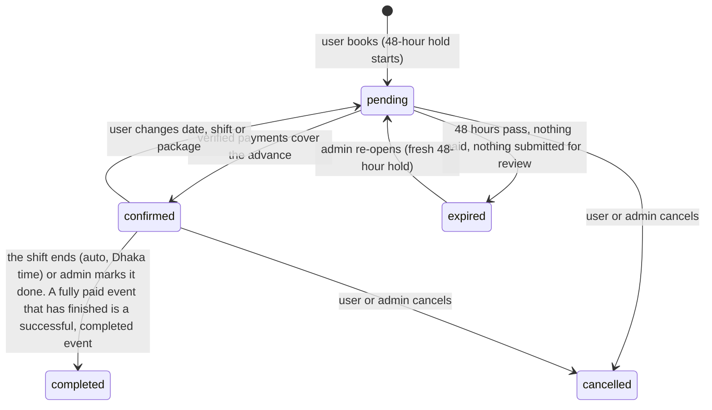

# Nikah Community Center — API (NCC Server)

   

REST API for the **Nikah Community Center** booking website (wedding & events venue, Chattogram, Bangladesh). Authentication is handled by Supabase (Google + email/password). Express only verifies the JWT, reads `profiles.role`, and enforces the business rules. Packages, food and images stay hard-coded in the frontend; only **profiles, bookings and payments** live in the database.

- **Frontend:** `Nikah-Community-Center-Frontend` (React + Vite) — https://nikah-convention.vercel.app/
- **Database / auth:** Supabase (Postgres)
- **Hosting:** Render free tier (API) + Vercel (frontend)

## Table of contents

- [Features](#features)
- [Project structure](#project-structure)
- [Setup](#setup)
- [Environment variables](#environment-variables)
- [Endpoints](#endpoints)
- [Booking lifecycle](#booking-lifecycle)
- [Payment deadline: auto-cancel after 48 hours](#payment-deadline-auto-cancel-after-48-hours)
- [Key rules](#key-rules)
- [Database](#database)
- [Tests](#tests)
- [Deploy (Render free)](#deploy-render-free)
- [Security notes](#security-notes)

## Features

- Supabase JWT auth with `user` and `admin` roles
- Bookings with **no double booking**, enforced by Postgres itself
- Server-side pricing (client prices are ignored), saved as a snapshot so old invoices never change
- Payment records (bKash, Nagad, bank, office, card) with admin verification; booking auto-confirms when the advance is covered
- **Unpaid bookings are cancelled automatically after 48 hours**; a submitted payment (any transaction ID) counts as paid for now, pauses the timer and goes to the admin "To verify" queue
- Public availability endpoint (booked days only, no personal data)
- Admin: search, filter, paginate, walk-in bookings, edit, cancel, delete, stats
- Audit log (`booking_events`) for every important action
- Rate limiting, Helmet, CORS allow-list, request validation with Zod

## Project structure

```bash
Nikah-Community-Center-Backend/
├── package.json
├── .env.example                  # copy to .env
├── .github/
│   └── workflows/
│       └── keepalive.yml         # pings /api/health every 3 days (keeps Render + Supabase awake)
├── supabase/
│   ├── schema.sql                # full schema for a NEW database (run once)
│   └── migrations/
│       ├── 002_hold_72h.sql      # older upgrade: 3-day payment hold
│       └── 003_hold_48h.sql      # upgrade for an EXISTING database: 48-hour payment hold
├── src/
│   ├── index.js                  # starts the server
│   ├── app.js                    # middleware, rate limits, route mounting, 404
│   ├── schemas.js                # Zod schemas: booking, patch, payment, admin list, profile
│   ├── config/
│   │   ├── env.js                # validated environment variables
│   │   └── pricing.js            # packages, shifts, add-ons, food, buildQuote()
│   ├── lib/
│   │   ├── supabase.js           # service-role client (server only)
│   │   ├── mappers.js            # DB row -> API shape
│   │   └── dates.js              # Dhaka "today", addDays, date validation
│   ├── middleware/
│   │   ├── auth.js               # requireAuth / requireAdmin
│   │   └── error.js              # httpError + JSON error handler
│   ├── routes/
│   │   ├── health.js             # GET /health (also sweeps unpaid bookings)
│   │   ├── availability.js       # GET /availability
│   │   ├── me.js                 # GET|PATCH /me
│   │   ├── bookings.js           # user bookings + payments + invoice
│   │   └── admin.js              # admin bookings, payments, stats
│   └── services/
│       └── bookingService.js     # create / update / cancel / recomputePaid
└── test/
    ├── pricing.test.js           # price rules
    └── smoke.test.js             # validation, auth guards, 404 (no Supabase needed)
```

## Setup

1. **Supabase** (free): create a project and note the Project URL, anon key and service_role key.
   - Auth → Providers: enable Email and Google (redirect URI `https://<ref>.supabase.co/auth/v1/callback`).
   - Auth → URL Configuration: Site URL `https://nikah-convention.vercel.app`; Redirect URLs `http://localhost:5173/**`, `http://localhost:3000/**` and `https://nikah-convention.vercel.app/**`. If Site URL is left as localhost, Google login on the live site bounces to localhost.
   - SQL Editor → run `supabase/schema.sql`.
   - Sign up once in the app, then make yourself admin:
     ```sql
     update public.profiles set role = 'admin' where email = 'YOUR_EMAIL';
     ```
2. `cp .env.example .env` and fill `SUPABASE_URL` and `SUPABASE_SERVICE_ROLE_KEY` (**server only, never in git or the frontend**).
3. `npm install && npm run dev` → http://localhost:4000/api/health
4. `npm test` (no Supabase needed: validation, pricing, auth guards).

**Already have a database from before?** Do not re-run `schema.sql`. Run `supabase/migrations/003_hold_48h.sql` once instead (see [below](#payment-deadline-auto-cancel-after-48-hours)).

## Environment variables

| Variable | Default | Description |
|---|---|---|
| `PORT` | `4000` | Server port |
| `SUPABASE_URL` | — | Supabase project URL |
| `SUPABASE_SERVICE_ROLE_KEY` | — | **Secret.** Server only, never in git or the frontend |
| `CLIENT_ORIGINS` | `http://localhost:5173` | Comma-separated allowed browser origins (put the Vercel URL here) |
| `HOLD_HOURS` | `48` | How long an unpaid pending booking keeps its date (48 hours) |
| `EDIT_CUTOFF_DAYS` | `3` | Users cannot edit a booking this close to the event |
| `MAX_PENDING_PER_USER` | `3` | Max unpaid bookings per user at once |

## Endpoints

All paths start with `/api`.

**Public**

| Method | Path | Description |
|---|---|---|
| GET | `/health` | Liveness + tiny DB query; also releases expired holds |
| GET | `/availability?from&to` | Booked days and shifts (max 400 days) |

**User** (Bearer token)

| Method | Path | Description |
|---|---|---|
| GET, PATCH | `/me` | Own profile |
| POST, GET | `/bookings` | Create / list own bookings |
| GET, PATCH | `/bookings/:id` | Read / edit own booking |
| POST | `/bookings/:id/cancel` | Cancel own booking |
| GET | `/bookings/:id/invoice` | Invoice data (price snapshot + verified payments) |
| POST | `/bookings/:id/payments` | Submit a payment (waits for admin verification) |

**Admin** (Bearer token, `role = admin`)

| Method | Path | Description |
|---|---|---|
| GET, POST | `/admin/bookings` | List (rows include the booker's `avatar`; `?verify=1` = only bookings with a payment waiting for verification) / create a walk-in booking |
| PATCH, DELETE | `/admin/bookings/:id` | Edit any field and status / hard delete |
| POST | `/admin/bookings/:id/cancel` | Cancel |
| POST | `/admin/bookings/:id/payments` | Record a payment (cash at office etc., stored as already verified) |
| PATCH | `/admin/payments/:id` | `{ status: 'verified' \| 'rejected' }` |
| GET | `/admin/stats` | Totals, revenue, upcoming events, `toVerify` (bookings with a payment to verify) |

Booking `:id` is the public code, e.g. `NCC-AB12CD`.

Each booking in a response carries `holdExpiresAt` (when the payment deadline ends), `holdHours` (length of the window) and `cancelReason`, so the frontend can draw its timers without hard-coding anything.

## Booking lifecycle



A walk-in booking created by an admin starts as `confirmed` with no hold.

## Payment deadline: auto-cancel after 48 hours

A booking made online starts as `pending` and holds its date and shift for `HOLD_HOURS` (default **48 hours**). The slot counts as taken during that time, so nobody else can book it.

When `hold_expires_at` passes, the Postgres function `expire_stale_holds()` sets the booking to `expired` and frees the slot, **only if**:

- no payment has been verified (`paid_amount = 0`), and
- no payment is waiting for admin review

So a guest who has submitted a bKash / Nagad / bank / card payment is never cancelled while staff are still checking it. Any transaction text is accepted at submit time (the booking shows "payment in review" and counts as paid for now); the admin verifies it against the real statement. A customer can have at most 3 payments waiting, and their total cannot exceed the balance. If the admin **rejects** a payment and nothing else is waiting, the customer gets a fresh 24 hours to pay again. Every automatic cancel stores a reason and writes an `auto_expired` row to `booking_events`.

**No cron job is needed.** The function runs lazily on every availability, booking-list, admin-list, admin-stats, booking-create and `/health` call. The GitHub keep-alive ping (every 3 days) also triggers it, and the frontend calls the API the moment a timer reaches zero.

**Upgrading an existing database**

1. Run `supabase/migrations/003_hold_48h.sql` in the Supabase SQL Editor. It gives bookings that are still waiting for payment the new 48-hour window, counted from when they were created (older ones keep a 12 h grace).
2. Set `HOLD_HOURS=48` in Render (48 is also the new default).
3. Redeploy the API.

## Key rules

- **No double booking:** Postgres exclusion constraint on `during` (error `23P01` → HTTP 409). A `full` day overlaps both morning and evening.
- **Pricing:** always computed in `src/config/pricing.js` (**keep in sync with frontend `src/data.js` and `src/lib/store.js`**) and stored as `price_snapshot`; old invoices never change. The snapshot is recomputed only when price inputs change.
- **Hold:** a pending booking holds its slot for `HOLD_HOURS`; see the section above.
- **Auto-confirm:** verified payments ≥ advance → booking becomes `confirmed` and the hold is cleared.
- **User edits:** pending or confirmed bookings only, at least `EDIT_CUTOFF_DAYS` before the event. A confirmed booking whose date, shift or package changes goes back to `pending` with a new hold.
- **Admin re-opening:** setting a booking back to `pending` starts a fresh hold and clears the cancel reason.
- **Deleting:** users never hard-delete (delete = cancel). Admins can.
- **Date rule:** bookings need tomorrow or later (Bangladesh time).

## Database

| Table | Purpose |
|---|---|
| `profiles` | One row per user (name, avatar, phone, `role`); created by a trigger on `auth.users` |
| `bookings` | Booking data, price snapshot, `status`, `hold_expires_at`, generated `during` range for the overlap constraint |
| `payments` | Submitted / recorded payments with `pending → verified / rejected` |
| `booking_events` | Audit log (created, updated, cancelled, payment events, `auto_expired`) |

Row Level Security is enabled with **no policies on purpose**: browsers can never read or write these tables directly; only this API (service role) can.

## Tests

```bash
npm test
```

Runs with Node's built-in test runner and needs no Supabase: price rules, request validation, auth guards, 404 and bad-JSON handling.

## Deploy (Render free)

1. New Web Service, root directory = this repo, build command `npm i`, start command `node src/index.js`.
2. Add the environment variables from the table above and put the Vercel URL in `CLIENT_ORIGINS`.
3. Free tier sleeps after about 15 minutes idle (the first call can take 30–60 s; the frontend shows a "waking up" hint).
4. `.github/workflows/keepalive.yml` pings `/api/health` every 3 days so the free Supabase project never pauses. Add the repo secret `API_URL` (for example `https://your-api.onrender.com`).

## Security notes

- `SUPABASE_SERVICE_ROLE_KEY` bypasses all database security. Keep it in the server environment only.
- Unknown booking codes return `404` (not `403`) so other people's codes are never revealed.
- Rate limits: 120 requests/min per IP on `/api`, 30/min on `/api/bookings`.
- Request bodies are limited to 50 kB and validated with Zod before any database call.
